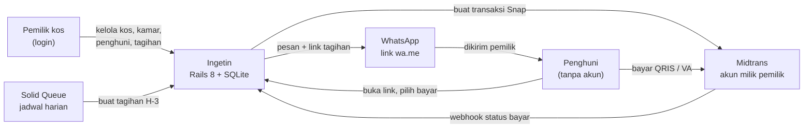
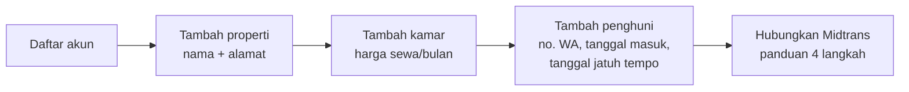
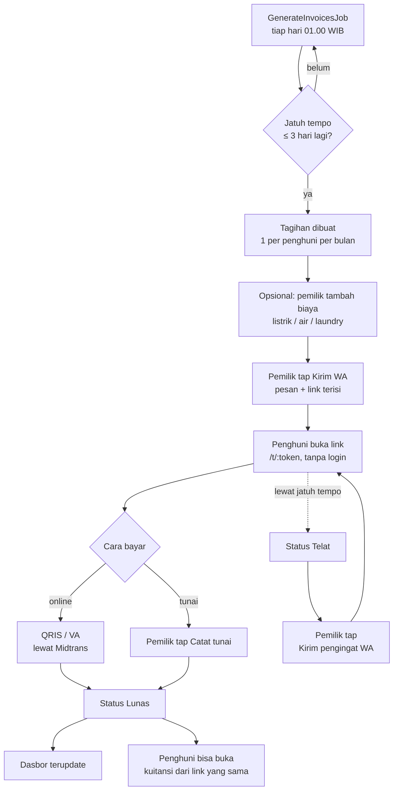
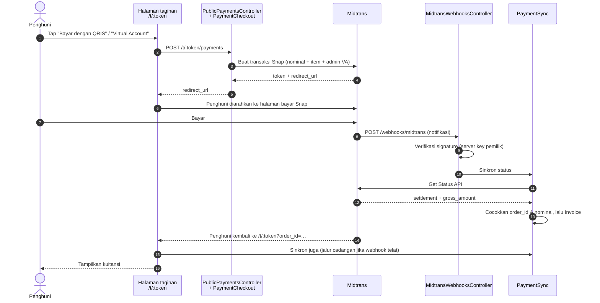
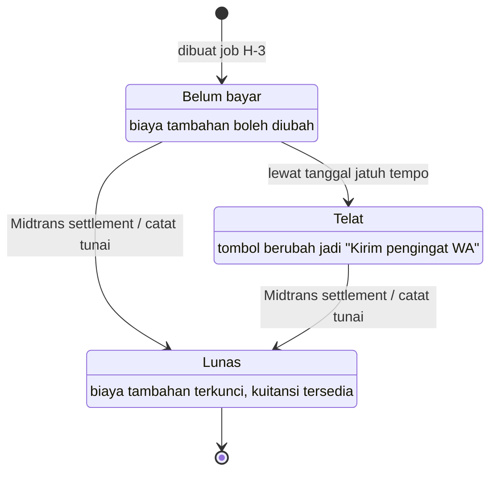
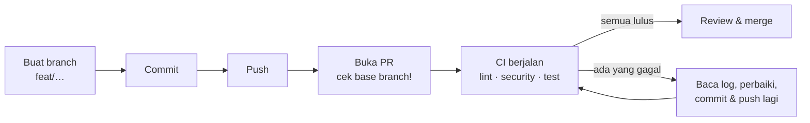
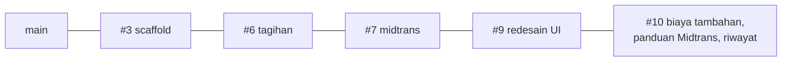

# Alur Aplikasi Ingetin

Dokumen ini menggambarkan **alur** Ingetin dari awal sampai akhir: siapa melakukan apa, kapan sistem bekerja otomatis, dan file kode mana yang menanganinya. Alasan di balik keputusan teknis ada di [`ARCHITECTURE.md`](ARCHITECTURE.md); isi dan prioritas fitur ada di [`PRD.md`](PRD.md).

Diagram ditulis dengan [Mermaid](https://mermaid.js.org/) dan dirender otomatis oleh GitHub. Untuk mengubahnya, cukup edit teks di blok ` ```mermaid `.

## Daftar isi

1. [Gambaran besar](#1-gambaran-besar)
2. [Persiapan awal pemilik kos](#2-persiapan-awal-pemilik-kos)
3. [Siklus tagihan bulanan](#3-siklus-tagihan-bulanan)
4. [Detail pembayaran Midtrans](#4-detail-pembayaran-midtrans)
5. [Status tagihan](#5-status-tagihan)
6. [Peta alur ke kode](#6-peta-alur-ke-kode)
7. [Alur kerja developer & CI](#7-alur-kerja-developer--ci)

## 1. Gambaran besar

Dua jenis pengguna: **pemilik kos** (login) dan **penghuni** (tanpa akun, cukup membuka link). Ingetin tidak pernah memegang uang; pembayaran masuk langsung ke akun Midtrans milik pemilik kos.



## 2. Persiapan awal pemilik kos

Dilakukan sekali. Tagihan baru bisa dibuat setelah ada penghuni aktif; pembayaran online baru bisa dipakai setelah Midtrans terhubung.



Panduan Midtrans di halaman **Pembayaran** punya 4 langkah yang tercentang otomatis:

| Langkah | Dianggap selesai jika |
|---|---|
| 1. Daftar & verifikasi akun Midtrans | Server key sudah tersimpan |
| 2. Simpan server key (+ tombol **Cek koneksi**) | Server key sudah tersimpan |
| 3. Pasang URL notifikasi (+ tombol **Salin**) | Notifikasi Midtrans pertama dengan signature valid sudah diterima (`users.midtrans_notified_at`) |
| 4. Coba satu pembayaran | Sudah ada pembayaran Midtrans yang lunas |

Paket Gratis dibatasi 10 kamar (`User::FREE_ROOM_LIMIT`).

## 3. Siklus tagihan bulanan

Inti aplikasi. Pemilik kos hanya terlibat saat menekan **Kirim WA** (dan opsional menambah biaya); sisanya otomatis.



Catatan:

- **Tidak ada tagihan dobel.** Satu penghuni hanya punya satu tagihan per periode (index unik `tenant_id + period`), jadi job aman dijalankan berulang.
- **Biaya tambahan** menaikkan total tagihan. `Invoice#amount` selalu berarti total; sewa pokok = total − jumlah biaya tambahan. Pesan WA, halaman penghuni, kuitansi, dan item di Midtrans ikut menampilkan rinciannya.
- **Biaya tambahan terkunci** jika tagihan sudah lunas, atau penghuni sedang menyelesaikan pembayaran VA (status `pending`) dengan nominal lama.

## 4. Detail pembayaran Midtrans

Status lunas **tidak** pernah dipercaya langsung dari isi notifikasi. Ingetin selalu memverifikasi signature lalu menanyakan ulang status ke Midtrans.



Pengaman yang ada:

- **Signature** dicek dengan server key pemilik tagihan (SHA-512). Signature salah → `401`.
- **Idempoten:** notifikasi ganda atau sinkron berulang tidak mengubah apa pun setelah lunas.
- **Nominal harus cocok.** Jika pemilik menambah biaya setelah transaksi dibuat, transaksi lama ditandai `superseded` dan tidak dipakai ulang. Settlement dengan nominal lama **tidak** otomatis menandai lunas; pemilik bisa memakai **Catat tunai** jika uangnya memang masuk.
- **Midtrans gagal dihubungi** saat webhook → balas `503` supaya Midtrans mencoba ulang.

## 5. Status tagihan

Di database hanya ada dua status (`unpaid`, `paid`). **Telat** dihitung saat ditampilkan: belum bayar dan sudah lewat `due_on`.



## 6. Peta alur ke kode

Untuk developer: langkah alur → file yang perlu dibuka.

| Langkah | File utama |
|---|---|
| Daftar, masuk, lupa sandi | `app/controllers/registrations_controller.rb`, `sessions_controller.rb`, `passwords_controller.rb` |
| Properti & kamar | `app/controllers/properties_controller.rb`, `rooms_controller.rb`, `app/models/property.rb`, `room.rb` |
| Penghuni & riwayatnya | `app/controllers/tenants_controller.rb`, `app/models/tenant.rb`, `app/views/tenants/show.html.erb` |
| Jadwal harian | `config/recurring.yml` → `app/jobs/generate_invoices_job.rb` |
| Membuat tagihan H-3 | `app/models/invoice_generator.rb` |
| Daftar, filter, & detail tagihan | `app/controllers/invoices_controller.rb`, `app/models/invoice_summary.rb`, `app/views/invoices/` |
| Biaya tambahan | `app/controllers/invoice_items_controller.rb`, `app/models/invoice_item.rb`, `Invoice#add_item!` / `#remove_item!` |
| Pesan WhatsApp | `app/models/invoice_message.rb`, `app/javascript/controllers/track_send_controller.js` |
| Halaman tagihan & kuitansi penghuni | `app/controllers/public_invoices_controller.rb`, `app/views/public_invoices/show.html.erb` |
| Membuat transaksi Snap | `app/controllers/public_payments_controller.rb`, `app/models/payment_checkout.rb`, `app/javascript/controllers/pay_controller.js` |
| Webhook & sinkron status | `app/controllers/midtrans_webhooks_controller.rb`, `app/models/payment_sync.rb` |
| Client Midtrans | `app/models/midtrans.rb`, `app/models/midtrans/client.rb` |
| Pengaturan & panduan Midtrans | `app/controllers/payment_settings_controller.rb`, `app/models/midtrans_connection_check.rb`, `app/views/payment_settings/` |
| Dasbor | `app/controllers/dashboard_controller.rb`, `app/views/dashboard/show.html.erb` |
| Tampilan & ikon | `app/assets/tailwind/application.css`, `app/views/layouts/application.html.erb`, `app/helpers/application_helper.rb` |

Test ada di `test/` dengan struktur yang sama (`test/models`, `test/controllers`, `test/jobs`). Di test, Midtrans diganti `test/test_helpers/fake_midtrans_client.rb`, jadi tidak ada request jaringan.

## 7. Alur kerja developer & CI

Setiap perubahan lewat branch dan Pull Request. **CI (GitHub Actions)** mengecek kode secara otomatis sebelum di-merge.



Job CI (`.github/workflows/ci.yml`):

| Job | Isi | Perintah lokal yang sama |
|---|---|---|
| `lint` | RuboCop (gaya kode) | `bin/rubocop` |
| `security` | Brakeman, Bundler audit, Importmap audit | `bin/brakeman`, `bin/bundler-audit`, `bin/importmap audit` |
| `test` | Cek migrasi cocok dengan `db/schema.rb`, seluruh test, lalu `db/seeds.rb` bisa dijalankan | `bin/rails db:migrate`, `bin/rails test`, `bin/rails db:seed:replant` |

CI berjalan saat PR **dibuka**, **dibuka ulang**, atau ada **commit baru** di branch-nya. Mengganti base branch saja tidak memicu CI.

**Contoh membaca CI yang gagal:** job `security` pernah gagal di langkah *Bundler audit* dengan pesan `Name: crass, Version: 1.0.7 … Solution: update to '>= 1.0.8'`. Artinya ada library dengan celah keamanan; perbaikannya menaikkan versi di `Gemfile.lock`, cek ulang dengan `bin/bundler-audit`, lalu push. CI otomatis berjalan lagi.

### Rantai PR saat ini

PR masih bertumpuk (setiap PR dibangun di atas PR sebelumnya), jadi merge dari bawah ke atas:



Setelah satu PR di-merge, GitHub biasanya otomatis memindahkan base PR berikutnya. Selalu cek bahwa base PR **bukan** `main` kecuali memang PR paling bawah.
